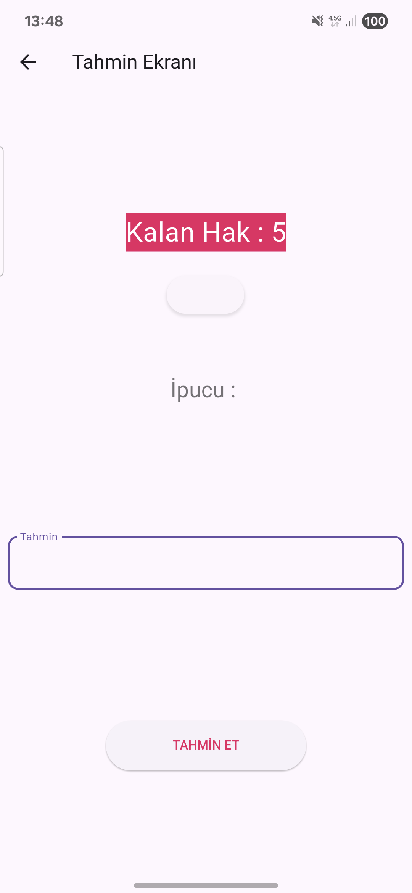
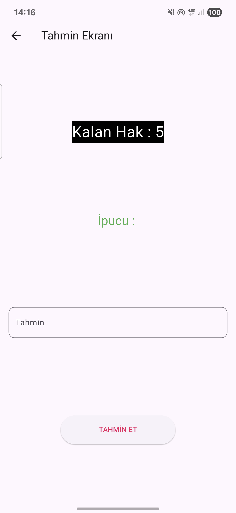

# Flutter Çalışmaları

Udemy Flutter kursu boyunca yazdığım ders kodları ve kurs dışında geliştirdiğim küçük uygulamalar. Her klasör kendi başına çalışan bir Flutter projesidir.

## Klasör Yapısı

```
.
├── bolum2 … bolum14     # Kurs bölümlerine ait ders kodları
└── uygulamalarim/       # Öğrendiklerimle yaptığım uygulamalar
```

## Kurs Bölümleri

| Klasör | Konu | İçerik |
| --- | --- | --- |
| [`bolum2`](bolum2/lib) | Dart temelleri | Değişkenler ve türleri, kapsam, sabitler, kaçış karakterleri, aritmetik operatörler, tür dönüşümü, konsol girdisi |
| [`bolum3`](bolum3/lib) | Kontrol yapıları | Karşılaştırma ve mantıksal operatörler, `if`, `switch`, `for` / `while`, `break` / `continue` ve örnekler |
| [`bolum4`](bolum4/lib) | Nesne yönelimli programlama | Sınıflar, fonksiyonlar, null safety, `late`, constructor, paketler, erişim belirteçleri, `static`, `enum`, composition, kalıtım, overriding, polymorphism, tip dönüşümü, interface ve ödevler |
| [`bolum7`](bolum7/lib) | Asenkron programlama | `Future`, `async` / `await` örnekleri, `try-catch` |
| [`bolum8`](bolum8/lib) | İlk Flutter uygulaması | Sayaçlı basit bir deneme sayfası |
| [`bolum_10`](bolum_10/lib) | Tasarım ve yerleşim | `Row`, `Column`, `Stack`, `Container`, hizalama, `Center`, `Align`, `SizedBox`, `Spacer`, `Padding`, `Expanded`, resim ekleme, çoklu ekran desteği |
| [`bolum11`](bolum11/lib) | Sayfa yönetimi | `setState`, Stateless / Stateful widget, sayfalar arası geçiş, geri tuşu, veri transferi, back stack, yaşam döngüsü, `FutureBuilder` |
| [`bolum12`](bolum12/lib) | Temel widget'lar | Text, buton türleri, `TextField`, FAB, switch, toggle, checkbox, radio, progress bar, slider, resim (asset / network), `ScrollView`, time picker, dropdown, `GestureDetector` |
| [`bolum13`](bolum13/lib) | Bildirim widget'ları | `SnackBar`, `AlertDialog`, `PopupMenu` |
| [`bolum14`](bolum14/lib) | Liste ve gezinme | Form, AppBar özelleştirme ve arama, `Card`, `ListView` / `GridView` (builder, tıklama, popup menü, yatay kaydırma), `FutureBuilder` ile listeleme, Tabs, `BottomNavigationBar`, `Drawer` |

> Bölüm 5, 6 ve 9 bu depoda yer almıyor.

Ders dosyaları numaralı (`1_…`, `2_…`) olduğundan, kursun akışını takip etmek için `lib` klasörlerini sırayla okumak yeterli.

## Uygulamalarım

| Uygulama | Açıklama |
| --- | --- |
| [`eat_app`](uygulamalarim/eat_app) | Yemek ve içecek listesi; bir ürüne tıklayınca detay sayfası açılıyor |
| [`movies_app`](uygulamalarim/movies_app) | `FutureBuilder` ile listelenen film kataloğu ve film detay sayfası |
| [`sayi_tahmin_uyg`](uygulamalarim/sayi_tahmin_uyg) | 0–50 arasında rastgele seçilen sayıyı ipuçlarıyla, sınırlı hakla tahmin etme oyunu |
| [`vericekme`](uygulamalarim/vericekme) | `http` paketiyle [FreeAPI](https://api.freeapi.app)'den kitap ve yemek verisi çekip listeleme |
| [`vericekme_v2`](uygulamalarim/vericekme_v2) | Aynı uygulamanın ikinci hâli; farklar aşağıda |
| [`yemek_tarifi_uygulamasi`](uygulamalarim/yemek_tarifi_uygulamasi) | Tek sayfalık yemek tarifi ekranı tasarımı |
| [`log_in_uygulamasi`](uygulamalarim/log_in_uygulamasi) | Giriş ekranı arayüz tasarımı |
| [`ilham_ver_uygulamasi`](uygulamalarim/ilham_ver_uygulamasi) | Profil fotoğrafı ve ilham verici bir yazıdan oluşan kişisel sayfa |
| [`ram`](uygulamalarim/ram) | `dart:ffi` ile bellek ayırma ve değişkenlerin bellekteki kimliğini (`identityHashCode`) inceleme denemesi |
| [`template`](uygulamalarim/template) | Generic fonksiyonlar ve `runtimeType` üzerine küçük denemeler |

### `vericekme` ve `vericekme_v2` Farkı

İki proje de veriyi `HttpServices.fetchItem<T>()` adlı tek bir generic fonksiyonla çekiyor. JSON'u modele çeviren fonksiyon parametre olarak veriliyor, böylece aynı servis hem kitap hem yemek listesi için kullanılıyor.

| | `vericekme` | `vericekme_v2` |
| --- | --- | --- |
| Dönüştürücü parametrenin adı | `fromJson` | `TElement` |
| `http` paketi | `^0.13.6` | `^1.2.1` |

```dart
// vericekme
HttpServices.fetchItem(apiLink: ..., fromJson: (json) => FetchValue<Book>.fromJson(json, Book.fromJson));

// vericekme_v2
HttpServices.fetchItem(apiLink: ..., TElement: (json) => FetchValue<Book>.fromJson(json, Book.fromJson));
```

### Ekran Görüntüleri

<p>
  
  
</p>

## Çalıştırma

Gereksinim: [Flutter SDK](https://docs.flutter.dev/get-started/install)

```bash
git clone https://github.com/FurkanOguzgoksu/flutter-studies.git
cd flutter-studies/uygulamalarim/sayi_tahmin_uyg   # istediğin proje klasörü
flutter pub get
flutter run
```

Ders klasörlerindeki tek başına Dart dosyaları (ör. `bolum2`, `bolum3`, `bolum4`, `bolum7`) doğrudan konsoldan çalıştırılabilir:

```bash
cd bolum4
dart run lib/3_fonksiyonlar.dart
```

Flutter widget örnekleri için dosyayı hedef göstererek çalıştırabilirsin:

```bash
cd bolum12
flutter run -t lib/4_switchKullanimi.dart
```
